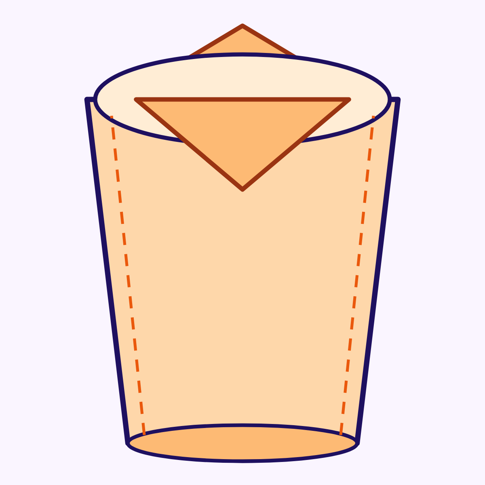

# #01 Paper Cup

Fold a real drinking cup from one square of paper. Ages **6+**, about **10 minutes**.

**Coding / maths link:** the folds are an **algorithm** — a list of steps in order. Skip one and the cup fails (that is a bug!).

## You need
- 1 square of paper **150 × 150 mm** (origami paper, or cut a square from A4)
- A flat table and clean hands
- Optional: a sip of water to test the cup (grown-up nearby)

## Print the sheet
Prefer the two-sided fold sheet, then the step cards:

1. **[fold-sheet.pdf](fold-sheet.pdf)** — Side A = fold/cut marks · Side B = coloured side. Print **both sides**, flip on the long edge, then cut out the square. Prefer this.
2. **[templates.pdf](templates.pdf)** (2× A4 pages) — cover + step cards. Print at **100% / Actual size** — do **not** choose “fit to page”. Measure the **100 mm** bar with a ruler.

Kid landing page (GitHub Pages): **[index.html](./)** — finished picture + all downloads.

- [fold-sheet-side-a.png](fold-sheet-side-a.png) · [fold-sheet-side-b.png](fold-sheet-side-b.png) — fold sheet sides  
- [page-1.png](page-1.png) · [page-1.svg](page-1.svg) — cover, true-size square, symbol key, Finished! preview  
- [page-2.png](page-2.png) · [page-2.svg](page-2.svg) — steps 1–7 + Finished! check  
- [final.png](final.png) — finished cup drawing  

## Symbol key
| Mark | Meaning |
|------|---------|
| Dashed **blue** | Valley fold (fold toward you) |
| Dash-dot **red** | Mountain fold (fold away) |
| ↻ | Turn the model over |
| → | Fold direction arrow |

## Step by step

1. **Diagonal valley** — Fold the top-left corner down to the bottom-right. Crease firmly. CHECK ✓: a triangle.
2. **Left corner up** — Fold the left tip up to the top peak. CHECK ✓: left flap meets the peak.
3. **Right corner up** — Fold the right tip up the same way (symmetry!). CHECK ✓: both sides match.
4. **Front lip down** — Fold the front top peak down into the little pocket. CHECK ✓: front lip tucked.
5. **Turn over** — Flip the whole model like a pancake.
6. **Back lip down** — Tuck the back peak the same way as step 4. CHECK ✓: both lips locked.
7. **Open the cup** — Squeeze the sides gently and push the bottom flat. CHECK ✓: a 3D cup with two flaps tucked!

## Finished!
Your cup should look like [final.png](final.png): open top, tapered body, **two flaps folded down** (front and back), flat bottom.

## Try it
Fold a second cup from a magazine page. Same algorithm — does it still work?

## Video
Episode for the **Origami for Kids** playlist on [@Kids.JoinDev](https://www.youtube.com/@Kids.JoinDev): [Fold a Paper Cup!](https://youtu.be/-gKPClIPDeE) (private / madeForKids).
