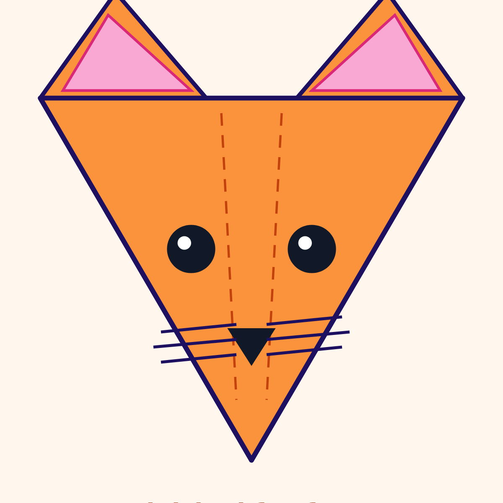

# #02 Fox Face

Fold a classic fox face with two ear peeks. Ages **6+**, about **10 minutes**.

**Coding / maths link:** **symmetry** — a mirror line down the middle. Left = right. Match each fold on both sides.

## You need
- 1 square of paper **150 × 150 mm** (origami paper, or cut a square from A4)
- A flat table and clean hands
- A dark marker **only if** you print the draw-your-own sheet or use plain paper

## Print the sheet
Two print options (both true-size A4):

1. **[fold-sheet.pdf](fold-sheet.pdf)** — Side A = fold/cut marks · Side B = **printed fox face** (eyes, nose, whiskers, ear shading) that lands correctly after folding. Prefer this.
2. **[fold-sheet-draw.pdf](fold-sheet-draw.pdf)** — Same folds, but Side B has **dotted guide outlines** so kids draw the face themselves with a marker.

Also bundled: **[templates.pdf](templates.pdf)** (cover + steps, Paper Cup style). Print at **100% / Actual size** — do **not** “fit to page”. Measure the black **100 mm** bar with a ruler.

- [fold-sheet-side-a.png](fold-sheet-side-a.png) · [fold-sheet-side-b.png](fold-sheet-side-b.png) — print-face sheet
- [fold-sheet-draw-side-a.png](fold-sheet-draw-side-a.png) · [fold-sheet-draw-side-b.png](fold-sheet-draw-side-b.png) — draw-your-own sheet
- [page-1.png](page-1.png) · [page-2.png](page-2.png) — cover + step cards
- [final.png](final.png) — finished fox

## Symbol key
| Mark | Meaning |
|------|---------|
| Dashed **blue** | Valley fold (fold toward you) |
| Dash-dot **red** | Mountain fold (fold away) |
| Dotted cut | Cut on the dots (if your sheet asks) |
| ↻ | Turn the model over |
| → | Fold direction arrow |
| Dotted face outlines (draw sheet) | Trace with a marker after the last fold |

## Step by step

1. **Big triangle** — Coloured side down, diamond. Fold the TOP corner down to the bottom. CHECK ✓: a big triangle, fold at the bottom.
2. **Left corner down** — Fold the left corner down to the bottom tip. CHECK ✓: one side flap done.
3. **Right corner down** — Fold the right corner the same way (symmetry!). CHECK ✓: both sides match.
4. **Left ear peek** — Fold the bottom tip up a little to the left. CHECK ✓: a little triangle peeks as the left ear.
5. **Right ear peek** — Same tip, a little to the right. CHECK ✓: two ear peeks.
6. **Turn over** — Flip the model so the coloured face side is up.
7. **Decorate the face** — If you used the **print** sheet, the eyes/nose/whiskers should already show. If you used the **draw** sheet or plain paper, trace the dotted guides (or freehand) with a dark marker. CHECK ✓: a fox face looking at you!

## Finished!
Your fox should look like [final.png](final.png): triangle face, two ear peeks, eyes + nose (printed or drawn).

## Try it
Fold a second fox from plain paper and draw a funny face — same folds, new expression.

## Video
Episode for the **Origami for Kids** playlist on [@Kids.JoinDev](https://www.youtube.com/@Kids.JoinDev): [Fold a Fox Face!](https://youtu.be/jkVGr6Ki0po) (private / madeForKids — replaces tip-hand draft `JTEiFMKbUes`). Robot claw matches Paper Cup.
