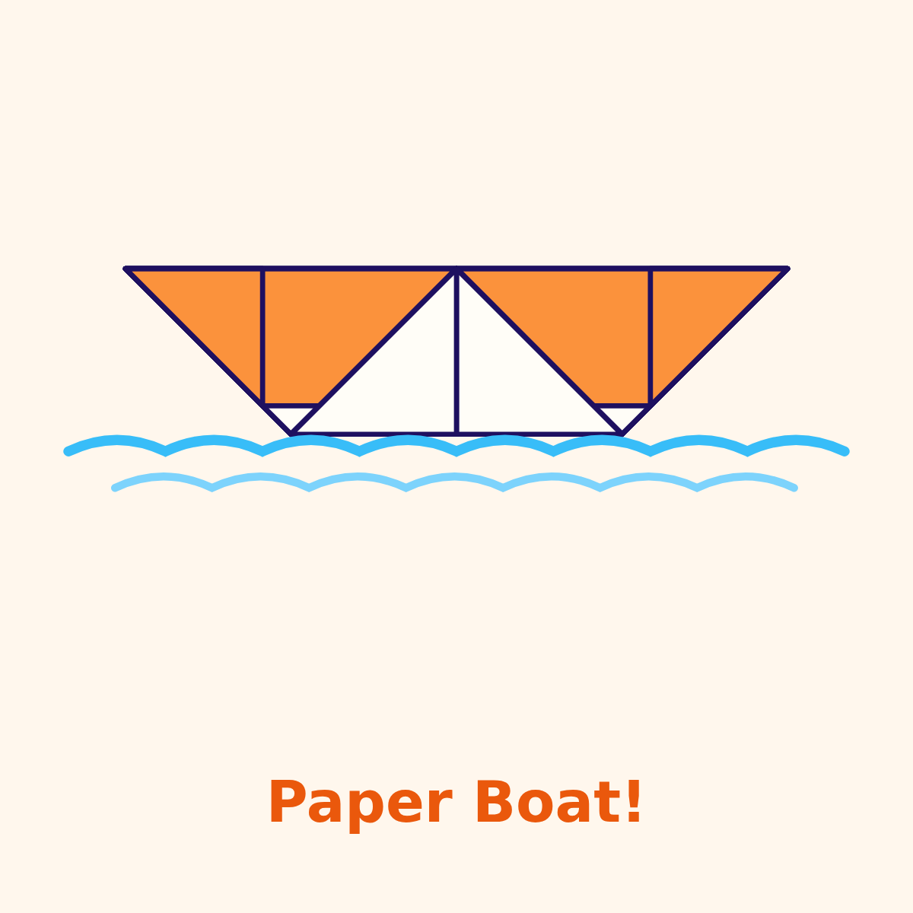

# #03 Paper Boat

Fold the classic paper boat from one A4 sheet — first a hat, then a boat that floats! Ages 6+, about 15 minutes.

▶ Video: https://www.youtube.com/watch?v=AoHSrkocugg&list=PLG27WuKuRInU

Maths / coding idea: **halves** (fold in half = ½, the middle line = ¼) and a **loop** — the “open to a diamond” move happens twice.

`fold-sheet.pdf` = the paper itself: print **both sides at 100%** (flip on the long edge) and fold the whole page — nothing to cut.

## Steps

1. **Fold in half** — Paper tall, side A up. Fold the top edge down to the bottom edge. *Check:* A wide rectangle, fold at the top. *Tip:* Match corners, then press.
2. **Middle crease** — Fold it in half side to side, press, then open it again. *Check:* A line down the middle. *Tip:* That line is your guide.
3. **Left corner down** — Fold the top-left corner down to the middle line. *Check:* A slope on the left. *Tip:* Fold both layers together.
4. **Right corner down** — Fold the top-right corner down to the middle line too. *Check:* A house with a strip at the bottom. *Tip:* Left = right: symmetry!
5. **Front strip up** — Fold the TOP layer of the bottom strip up over the triangle. *Check:* A band across the front. *Tip:* Only the top layer!
6. **Turn over** — Flip it over like a pancake. *Check:* The band's little corners stick out. *Tip:* Point stays at the top.
7. **Lock the hat** — Fold the two little corners over the slopes, onto this side. *Check:* The corners lie on the triangle. *Tip:* Press them flat.
8. **Back strip up** — Fold the bottom strip up over them, the same as step 5. *Check:* A paper hat! *Tip:* The strip holds the corners: locked.
9. **Turn over** — Flip it over again. *Check:* The other little corners stick out. *Tip:* Point stays at the top.
10. **Lock it again** — Fold these two little corners over too. *Check:* A neat triangle hat. *Tip:* Same move as step 7.
11. **Open to a diamond** — Open the hat at the bottom, push the ends together, press flat. *Check:* A diamond! *Tip:* Thumbs inside the hat.
12. **Front corner up** — Fold the bottom corner of the front layers up to the top. *Check:* A triangle in front. *Tip:* Only the front layers.
13. **Turn over** — Flip it over, point still at the top. *Check:* The other bottom corner is free. *Tip:* Like a pancake again.
14. **Back corner up** — Fold that bottom corner up to the top too. *Check:* A smaller hat. *Tip:* Same move as step 12.
15. **Diamond again** — Open it at the bottom and flatten it into a smaller diamond. *Check:* A small diamond. *Tip:* Same move as step 11: a loop!
16. **Stand up, pull** — Hold the two top points, stand the diamond up straight, then gently pull them apart. *Check:* A boat with a sail! *Tip:* Pull slowly.
17. **Open the boat** — Open the bottom a little so it can float. *Check:* Your boat stands up. *Tip:* Float it on a tray of water!

## Files

- `fold-sheet.pdf` — the two-sided A4 paper with printed lines and numbers (fold the whole page)
- `templates.pdf` — cover, steps 1–8, steps 9–17
- `final.png` — the finished boat
