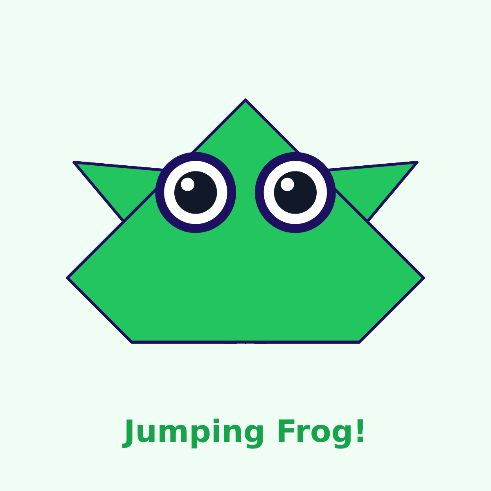

# #04 Jumping Frog

Fold a paper frog that really jumps! Ages 7+, about 15 minutes, one 150 mm square.

▶ Video: https://www.youtube.com/watch?v=FTvjNyp0yFY&list=PLG27WuKuRInU
Coding idea: the zig-zag spring **stores energy**, and pressing the back is the **trigger** (event → action).

**Print at 100% / actual size** and check the 100 mm bar. `fold-sheet.pdf` = print both sides (flip on the long edge).

## Steps

1. **Big triangle** — Green side down, turned like a diamond. Fold the BOTTOM corner up to the top. *Check:* A big triangle, point up. *Tip:* Crease with a fingernail.
2. **Left corner up** — Fold the left corner up to the top point. *Check:* Half a diamond. *Tip:* Line the edges up first, then press.
3. **Right corner up** — Fold the right corner up to the top point too. *Check:* A diamond (a square on its point). *Tip:* Same as the left, mirrored.
4. **Left front leg** — Fold the tip of the left flap out to the side on the dashed line. *Check:* A leg sticks out on the left. *Tip:* Fold both layers.
5. **Right front leg** — Fold the tip of the right flap out the same way. *Check:* Two front legs! *Tip:* Make both legs match.
6. **Back up** — Fold the bottom point up along the line. *Check:* A flat edge at the back. *Tip:* Press hard — this is the spring.
7. **Spring fold** — Fold that flap back down, halfway, on the line. *Check:* A zig-zag: the spring! *Tip:* Zig-zag = stored energy.
8. **Turn over** — Flip the frog over like a pancake. *Check:* Eyes on top, legs out the sides. *Tip:* The spring is now underneath.
9. **Jump!** — Press the back edge down with one finger, then slide it off. *Check:* Boing! The frog hops. *Tip:* Thicker paper jumps higher.

## Files

- `fold-sheet.pdf` — two-sided fold sheet with printed lines, numbers and eyes
- `templates.pdf` — cover, steps 1–8, jump page
- `final.png` — the finished frog
