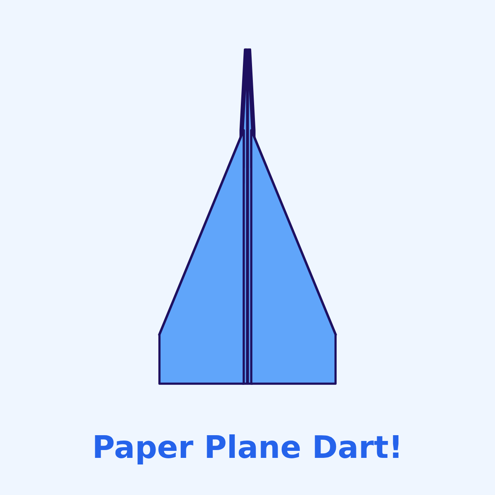

# #05 Paper Plane Dart

Fold the classic dart paper plane from one A4 sheet — and throw it! Ages 7+, about 10 minutes.

▶ Video: https://www.youtube.com/watch?v=CI7qJ5zEAVA&list=PLG27WuKuRInU

Maths / coding idea: the middle line is a **line of symmetry** (left = right), and each corner fold **halves the angle** (90° → 45° → 22.5°).

`fold-sheet.pdf` = the paper itself: print **both sides at 100%** (flip on the long edge) and fold the whole page — nothing to cut.

## Steps

1. **Middle crease** — Paper tall, side A up. Fold it in half side to side, press, then open it again. *Check:* A line down the middle. *Tip:* That line is the centre of your plane.
2. **Left corner in** — Fold the top-left corner down to the middle line. *Check:* A slope on the left. *Tip:* Corner tip right on the line.
3. **Right corner in** — Fold the top-right corner to the middle line too. *Check:* A house roof on top! *Tip:* Left = right: symmetry!
4. **Left edge in** — Fold the left slanted edge to the middle line again. *Check:* A long sharp slope. *Tip:* The point stays sharp.
5. **Right edge in** — Fold the right slanted edge to the middle line. *Check:* A sharp rocket nose. *Tip:* Same move, other side.
6. **Turn over** — Flip it over like a pancake, nose still at the top. *Check:* Smooth back, folds underneath. *Tip:* Nose stays pointing up.
7. **Fold in half** — Fold the right half over onto the left half. *Check:* A thin long triangle. *Tip:* Folds now on the outside.
8. **Wing down** — Fold the top layer over on the wing line. *Check:* One wing lies flat. *Tip:* Only the top half!
9. **Turn over** — Flip the plane over. *Check:* The other wing is on top. *Tip:* Keep the nose pointing up.
10. **Other wing** — Fold this wing on its line too, the same as step 8. *Check:* Both wings folded. *Tip:* Match the first wing.
11. **Open the wings** — Hold the body underneath and open both wings out flat. *Check:* A T shape from the front. *Tip:* Wings level, not drooping.
12. **Throw it!** — Hold the body, aim a little up, and push it gently forward. *Check:* It glides! *Tip:* Gentle and level beats hard.

Safety: throw it in an open space, never at people or animals.

## Files

- `fold-sheet.pdf` — the two-sided A4 paper with printed lines and numbers (fold the whole page)
- `templates.pdf` — cover, steps 1–6, steps 7–12
- `final.png` — the finished plane
