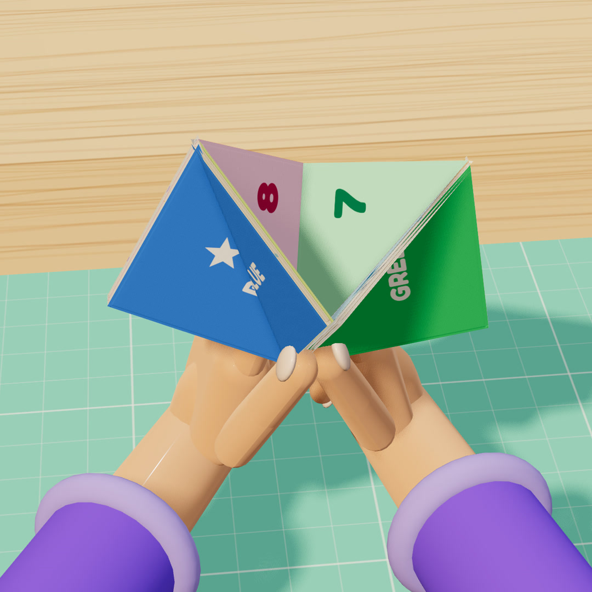

# #06 Fortune Teller

Fold a fortune teller, pick a colour, count, lift a flap — and do what it says! Ages 7+, about 15 minutes, one 150 mm square.

▶ Video: https://www.youtube.com/watch?v=1pQ-KgtHQUg&list=PLG27WuKuRInU

Coding idea: **loops inside loops**. Spell the colour (one open per letter), count to the number, then lift the flap: the result.

**Print at 100% / actual size** and check the 100 mm bar. `fold-sheet.pdf` = print both sides (flip on the long edge).
`fold-sheet-draw.pdf` = the same with blank fortunes: write your own!

## Steps

1. **Triangle crease** — Square, white side up. Fold the bottom corner up to the top corner. Press, then open. *Check:* One line, corner to corner. *Tip:* Line the corners up first.
2. **The other way** — Turn the paper a quarter. Fold corner to corner again. Press, then open. *Check:* A big X. The middle is the star. *Tip:* Press with a fingernail.
3. **Corners to the star** — Fold each corner to the star in the middle. Press, turn the paper, next corner. *Check:* A smaller square. *Tip:* Four corners, four folds.
4. **Turn over** — Flip it over like a pancake. *Check:* A smooth square, no flaps. *Tip:* Keep it flat.
5. **Corners again** — Fold each corner to the middle again. Press, turn, next corner. *Check:* Numbers on top! *Tip:* Same move as step 3.
6. **Fold in half** — Fold it in half like a book. Press, then open. *Check:* A line across the middle. *Tip:* No printed line: edges meet.
7. **Half the other way** — Turn it a quarter. Fold in half again. Press, then open. *Check:* A plus sign of creases. *Tip:* Press well: it helps the pop.
8. **Pop it up** — Pick it up. Thumbs and pointer fingers into the four pockets underneath. Push the corners together. *Check:* Four points meet at the top. *Tip:* Wiggle the pockets open first.
9. **Play!** — Pick a colour and spell it, opening one way, then the other. Pick a number, count, lift the flap. *Check:* Read the fortune and do it! *Tip:* R-E-D = 3 opens.

## How to play

1. A friend picks a colour. Spell it, opening the teller once per letter (one way, then the other).
2. They pick a number inside. Count to it, opening each time.
3. They pick a number again. Lift that flap, read the fortune, and do it!

## Files

- `fold-sheet.pdf` — two-sided fold sheet: lines, numbers, colours and fortunes printed
- `fold-sheet-draw.pdf` — the same with blank fortunes to write your own
- `templates.pdf` — cover, steps 1–6, steps 7–9 + how to play
- `final.png` — the finished fortune teller
