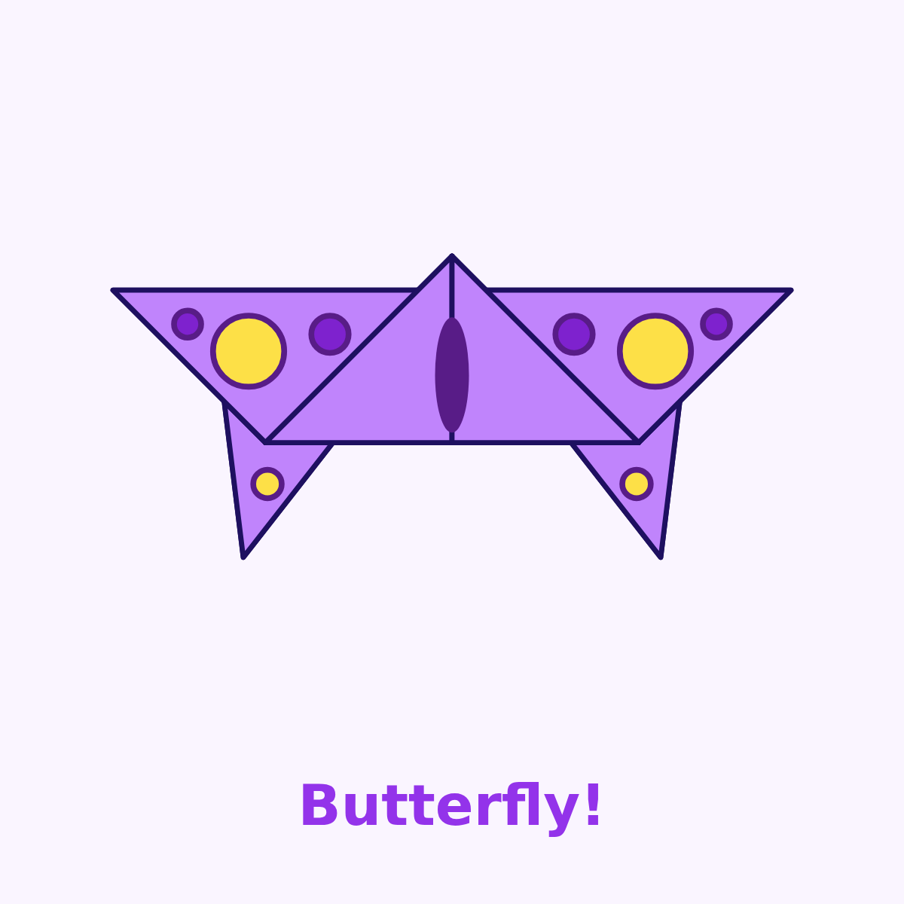

# #08 Butterfly

Fold a butterfly whose wings flap when you pinch it! Ages 8+, about 15 minutes, one 150 mm square.

▶ Video: https://www.youtube.com/watch?v=pgO5RMiZlC8&list=PLG27WuKuRInU
Coding idea: steps 1–5 make the **waterbomb base** — the same start as a balloon, a frog and a lily. A base is a **function**: write the steps once, reuse them in many models.

**Print at 100% / actual size** and check the 100 mm bar. `fold-sheet.pdf` = print both sides (flip on the long edge).

## Steps

1. **Crease the middle** — Purple side up. Fold the bottom edge up to the top edge. Press, then open it again. *Check:* One line across the middle. *Tip:* Edges together first.
2. **Turn over** — Flip the paper over like a pancake. *Check:* White side up. *Tip:* Keep the middle line going side to side.
3. **Corner to corner** — Fold the bottom right corner up to the top left corner. Press, then open. *Check:* A slanted line. *Tip:* Crease with a fingernail.
4. **The other corners** — Fold the bottom left corner up to the top right corner. Press, then open. *Check:* An X with a line through it. *Tip:* They cross in the middle.
5. **Magic collapse** — Push both ends of the middle line in. The bottom edge flips over to the top. *Check:* A triangle: the waterbomb base! *Tip:* The creases do the work.
6. **Left lower wing** — Top flap only: fold the left corner down on the line. It pokes out past the edge. *Check:* A wing tip sticks out. *Tip:* Start at the top middle.
7. **Right lower wing** — Fold the right corner down the same way. *Check:* Two wing tips, left and right. *Tip:* Make both sides match.
8. **Turn over** — Flip it over, side to side. *Check:* A smooth triangle with two tips peeking out. *Tip:* The point still points at you.
9. **The head** — Fold the bottom point up on the line. Its tip pokes just over the top edge. *Check:* A butterfly with a tiny head! *Tip:* The little wings stay flat.
10. **Fold in half** — Fold the right wing over onto the left wing. Press the middle. *Check:* Half a butterfly. *Tip:* The spots hide inside.
11. **Flutter!** — Hold the fold underneath and let the wings open. Pinch gently, let go, pinch… *Check:* Flap, flap — it flies! *Tip:* Open the wings wide to show the spots.

## Files

- `fold-sheet.pdf` — two-sided fold sheet with printed lines, numbers and wing spots
- `templates.pdf` — cover, steps 1–8, steps 9–11 + flutter tips
- `final.png` — the finished butterfly
