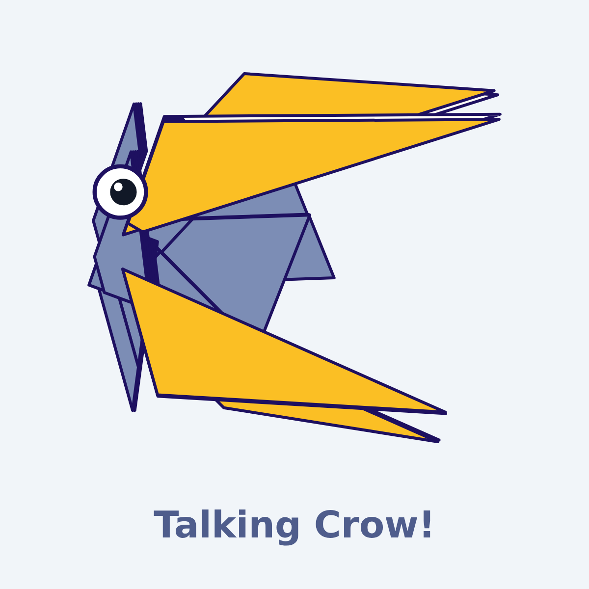

# #10 Talking Crow

Fold a crow that talks: pull its sides apart and the beak opens! Ages 8+, about 15 minutes, one 150 mm square.

▶ Video: https://www.youtube.com/watch?v=7XJohWS1JrQ&list=PLG27WuKuRInU
Coding idea: **input → output**. Your hands give the input (pull or push the sides); the beak is the output (open or shut). The same input always gives the same output.

**Print at 100% / actual size** and check the 100 mm bar. `fold-sheet.pdf` = print both sides (flip on the long edge).

## Steps

1. **Crease the middle** — Blue side down, like a diamond. Fold the left corner over to the right corner. Open. *Check:* One line down the middle. *Tip:* Press with a fingernail.
2. **Kite** — Fold the two bottom edges in to the middle line. *Check:* A kite, point toward you. *Tip:* Edges meet, no gap.
3. **Diamond** — Fold the two top edges in to the middle line too. *Check:* A long thin diamond. *Tip:* Keep the points sharp.
4. **Fold in half** — Fold the bottom point up to the top point. *Check:* A tall triangle, two points on top. *Tip:* Flaps stay inside.
5. **Make the step** — Fold the front point back down on the line: a finger above the bottom edge. *Check:* One point up, one point down. *Tip:* The step is the hinge.
6. **Beak crease 1** — Fold the top point down to the right, from the middle of the step. Open. *Check:* A slanted line on the top point. *Tip:* Middle line lands on the step.
7. **Beak crease 2** — Fold the top point down to the left the same way. Open. *Check:* A V of lines above the step. *Tip:* Press hard.
8. **Beak crease 3** — Fold the bottom point up to the right, from the middle of the step. Open. *Check:* A slanted line on the bottom point. *Tip:* Same as the top.
9. **Beak crease 4** — Fold the bottom point up to the left. Open. *Check:* An X of lines around the step. *Tip:* Four creases = the beak.
10. **Pop the beak** — Fold it in half like a book. Push both points forward, in between the two sides. *Check:* Both points stick out the front. *Tip:* Use your four creases.
11. **Talk!** — Hold the two sides. Pull them apart, push them together. Caw! Caw! *Check:* The beak opens and shuts. *Tip:* Pull = open, push = shut.

## Files

- `fold-sheet.pdf` — two-sided fold sheet with printed lines, numbers, a yellow beak and eyes
- `templates.pdf` — cover, steps 1–8, steps 9–11 + talk tips
- `final.png` — the finished crow
